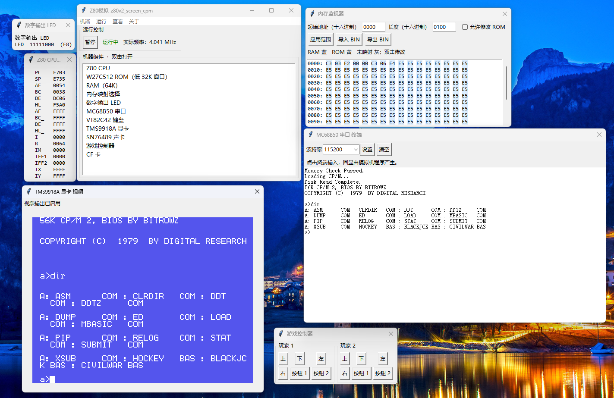
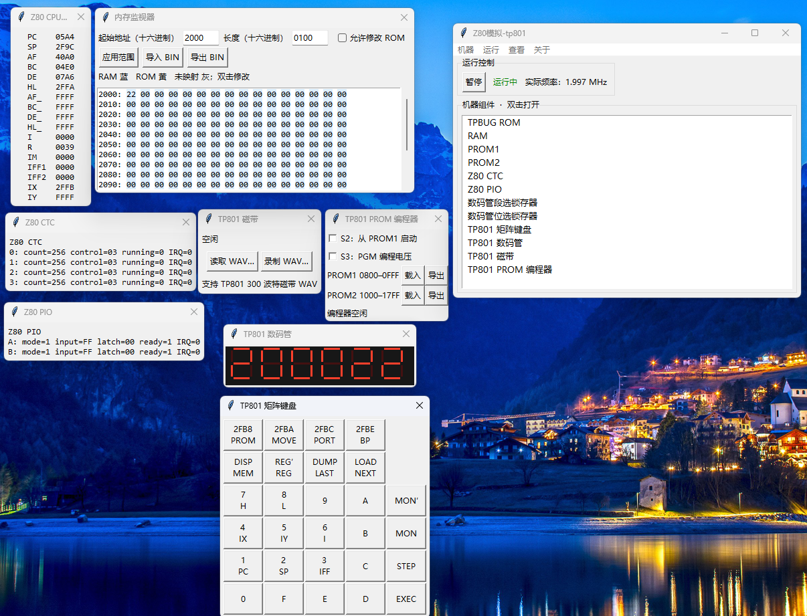
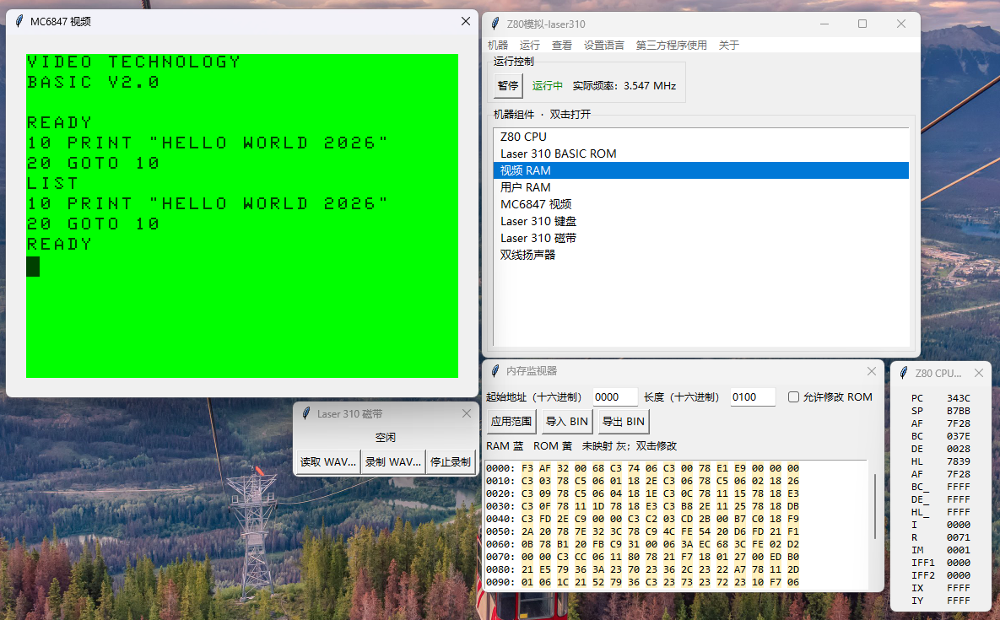
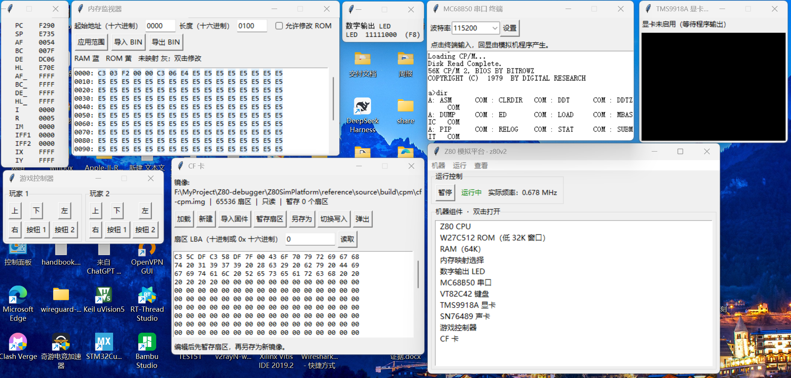
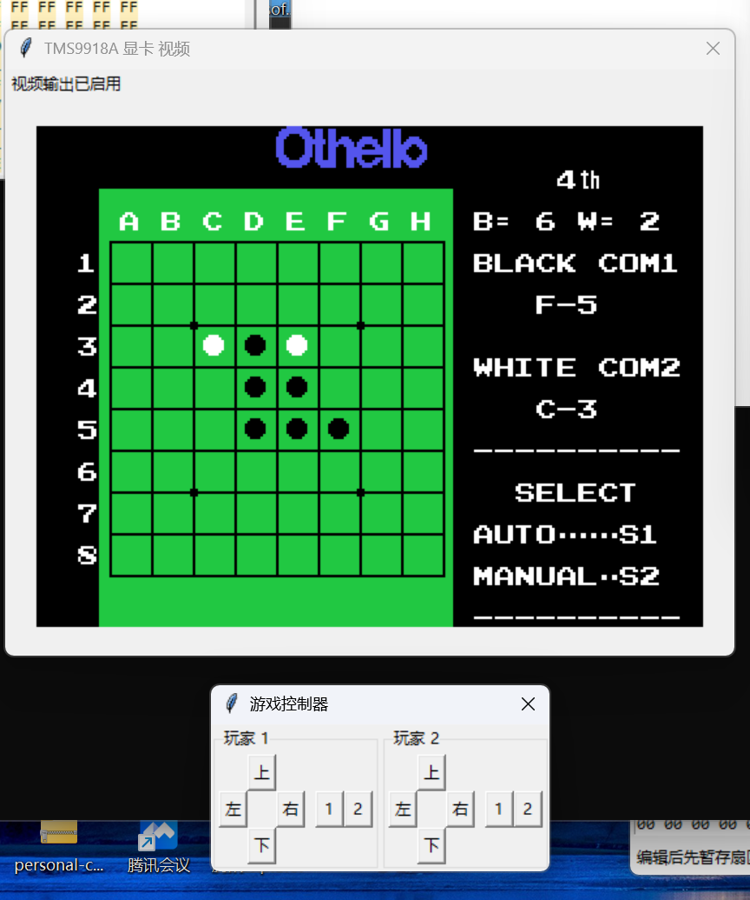
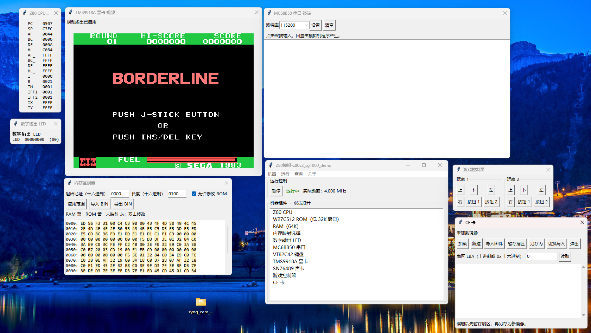
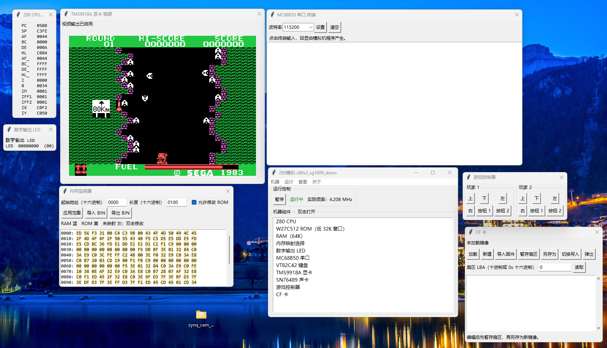
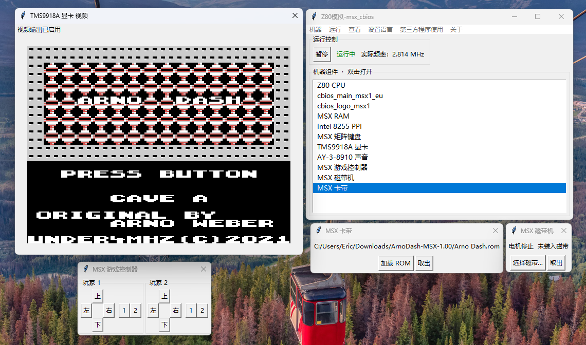
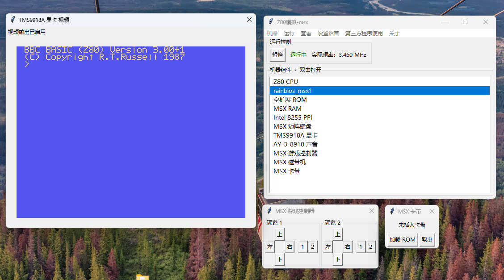

# z80cemu

A Python Z80 simulation platform. There is no single fixed computer here. You describe your own machine in a short Python script: memory map, chips, port decoding, wiring, clock. Nine complete machines ship with it, all running real firmware.



The CPU is [redcode/Z80](https://github.com/redcode/Z80), so the firmware really runs: the TP801 monitor, Laser 310 BASIC, MSX BASIC and CP/M 2.2 all boot the way they do on the hardware. Peripherals are separate Python objects (CTC, PIO, a TMS9918A, a CompactFlash card), and each one opens its own window you can watch and poke at while the machine runs.

## Requirements

- Windows, Python 3.8+ with Tkinter. The launchers call `py -3.10`; if your interpreter has another name or version, edit the `.cmd` files.
- Python must match the bitness of the Z80 core in `lib/bin/Z80.dll`. It is a build of [redcode/Z80](https://github.com/redcode/Z80), so you can rebuild it or drop in another copy.

## Running it

Double-click a launcher:

```
start-z80v2.cmd        Z80-V2, CP/M 2.2 on the serial terminal
start-cpm-screen.cmd   same board, CP/M console on the video output
start-sg1000-demo.cmd  SG-1000 style display demo
start-tp801.cmd        TP801 single-board computer
start-laser310.cmd     VTech Laser 310
start-msx.cmd          MSX1 with RainBIOS (BASIC)
start-msx-cbios.cmd    MSX1 with C-BIOS
```

Or from a terminal:

```
py -3.10 app.py --machine machines/z80v2.py
```

`--machine` is required — `start.cmd` on its own only prints that hint. Once the window is up, double-click any component in the list to open its window, then hit Run. On the TP801 you should see a `P` appear on the digit display.

The UI starts in Chinese. `设置语言` in the menu bar switches it to English, and the choice is remembered in `%APPDATA%\Z80SimPlatform\settings.json`.

## Machines included

| Script | What it is |
| --- | --- |
| `machines/generic.py` | Bare 1 MHz Z80, 8K ROM, 56K RAM, a CTC, a PIO and an ACIA. Good starting point. |
| `machines/wired_example.py` | Same idea plus one Python wire: the CTC output pulse drives the PIO strobe. |
| `machines/tp801.py` | TP801 at 2 MHz: TPBUG monitor, 7-segment display, matrix keypad, PROM programmer, and a cassette deck that reads and writes WAV files. |
| `machines/z80v2.py` | Bitrowz Z80-V2 at 4 MHz: TMS9918A, SN76489, VT82C42 keyboard, CF card, joypads. Boots CP/M 2.2 off the CF image. |
| `machines/z80v2_screen_cpm.py` | The same board with CP/M's console routed to the TMS9918A; type into the video window. |
| `machines/z80v2_sg1000_demo.py` | SG-1000 style display demo ROM written for this project. |
| `machines/laser310.py` | Laser 310 at 3.55 MHz: MC6847 video, keyboard, cassette, printer, 2-bit speaker, VTech BASIC. |
| `machines/msx.py` | MSX1 with RainBIOS, i8255, AY-3-8910, cartridge and cassette slots. |
| `machines/msx_cbios.py` | MSX1 with C-BIOS 0.29 instead of RainBIOS. |

## Making your own

A machine is just a `build()` that returns `(machine, clock_hz)`:

```python
from platform_core import Machine
from components.extends.z80_pio import Z80PIO

def build():
    machine = Machine({'memory': [
        {'name': 'ROM', 'type': 'rom', 'start': 0x0000, 'size': 0x2000},
        {'name': 'RAM', 'type': 'ram', 'start': 0x2000, 'size': 0xe000},
    ]})
    machine.attach_decoded_io('Z80 PIO', Z80PIO(0x14), 0x14, 0xff, 4)
    return machine, 1_000_000
```

Save it as `machines/mine.py` and run `py -3.10 app.py --machine machines/mine.py`. A chip can be mapped over several memory windows at different offsets, I/O can be attached by exact address or by address mask, and devices are plain classes with `read_port`/`write_port` plus optional `tick`, `reset` and interrupt hooks. New chips are one file each in `components/extends/`.

`HowToCustomizeMachinesAndComponents.md` walks through all of it — it's still in Chinese, sorry.

## Screenshots

| | |
| --- | --- |
|  |  |
| TP801: digits, keypad, PROM programmer and cassette, with the real CTC and PIO next to them. | Laser 310 booted into its BASIC. |
|  |  |
| Z80-V2 running CP/M over the serial terminal, CF image mounted read-only. | A real SG-1000 cartridge (Othello) on the Z80-V2 board. |
|  |  |
| Borderline booting. The ROM was swapped in through the memory monitor. | The same game a few seconds later. |
|  |  |
| MSX1 on C-BIOS, cartridge loaded from the cartridge window. | MSX1 on RainBIOS, sitting at the BASIC prompt. |

## How the repo is laid out

| Path | Contents |
| --- | --- |
| `app.py` | Tk window, menus and the run loop |
| `platform_core.py` | The machine: memory cache, I/O decoding, interrupt chain, run/pause/step |
| `components/` | Core parts (CPU, RAM, ROM); individual chips live in `components/extends/` |
| `boards/` | Board-level glue for TP801, Z80-V2, MSX1 and Laser 310 |
| `machines/` | The machine scripts. This is the part you edit |
| `ui/` | Shared windows: memory monitor, CF editor, port view |
| `platform_support/` | Settings, translation, keyboard, audio, signal helpers |
| `firmware/` | Boot ROMs and disk images the samples use |
| `tests/` | 35 unittest files, including boots of the bundled CP/M image |
| `reference/` | Upstream sources and toolchains used to build that firmware. Large, and not needed to run anything. |

## Tests

```
py -3.10 -m unittest discover -s tests -v
```

Some of them boot the real CP/M image and check that it reaches `a>` and runs `DIR`, so they take a moment.
